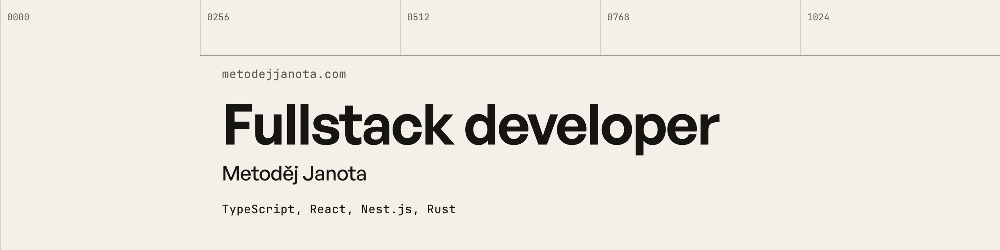

Hi, I'm Metoděj, a fullstack developer working mostly in TypeScript. In my own time I work on Octa, a set of tools that collect nothing about the people who use them. The first one is Tilde, a web browser with a core in Rust. It isn't public yet.

I like fast setups, keyboard-only workflows and tweaking things until they get out of my way.

### Usually in my editor

TypeScript, React, Nest.js, Svelte, Rust, Tailwind CSS, MongoDB, PostgreSQL, Docker

### Say hi

[dev@metodejjanota.com](mailto:dev@metodejjanota.com) · [metodejjanota.com](https://www.metodejjanota.com) · [LinkedIn](https://www.linkedin.com/in/metod%C4%9Bj-janota/)

The contribution graph looks quieter than it was: older commits went out under a previous email.
